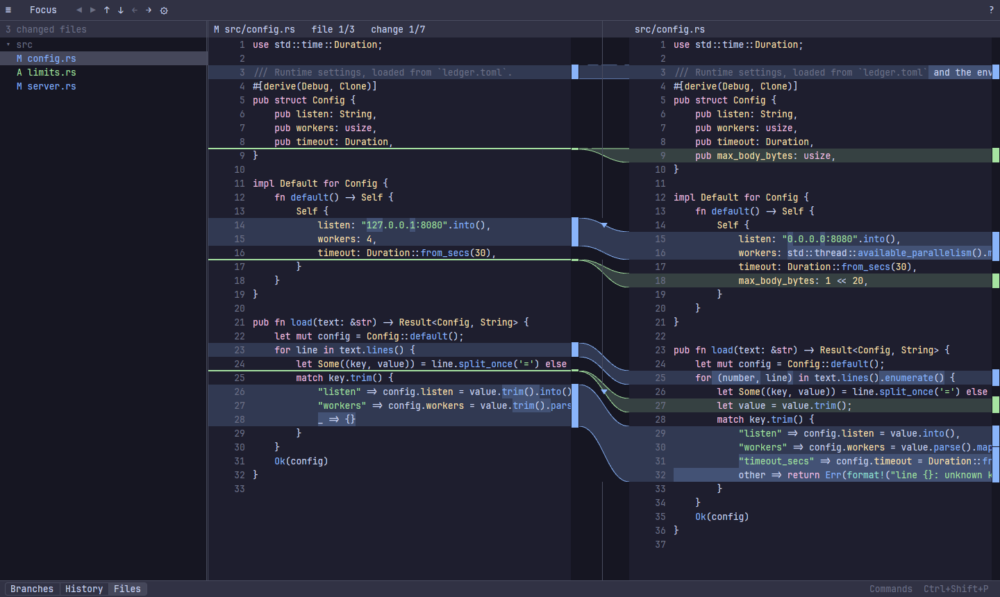
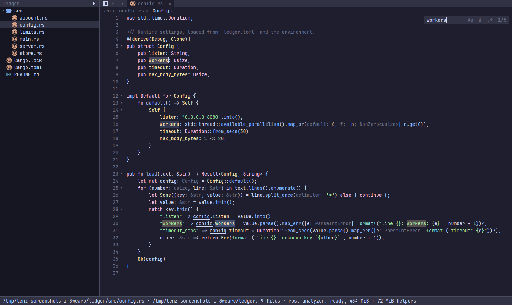
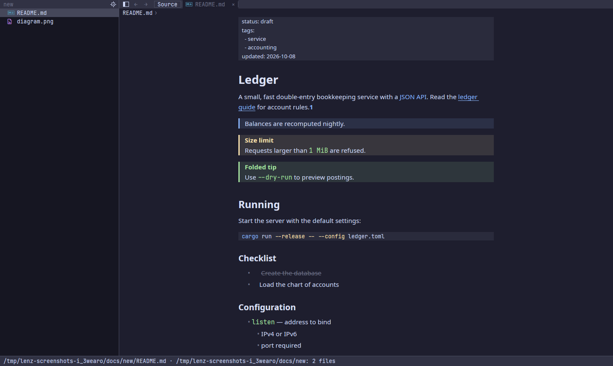
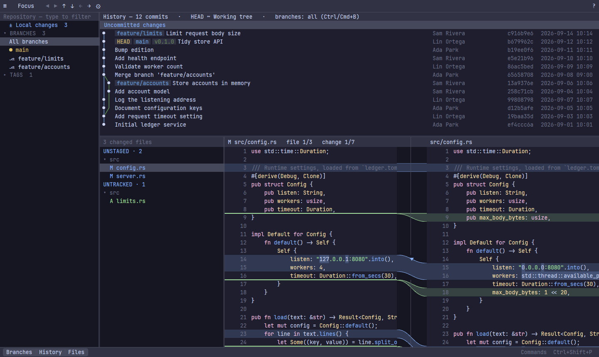
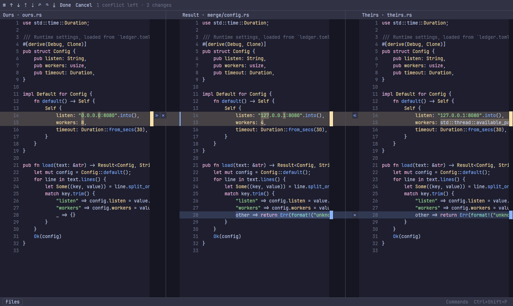
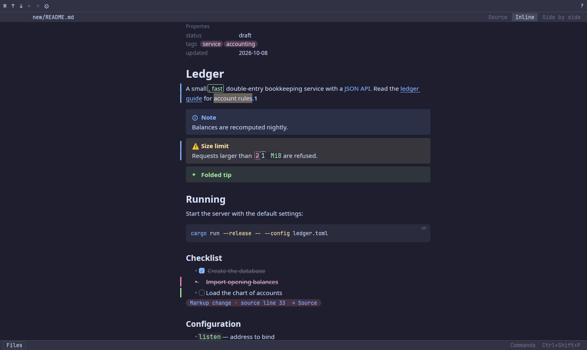
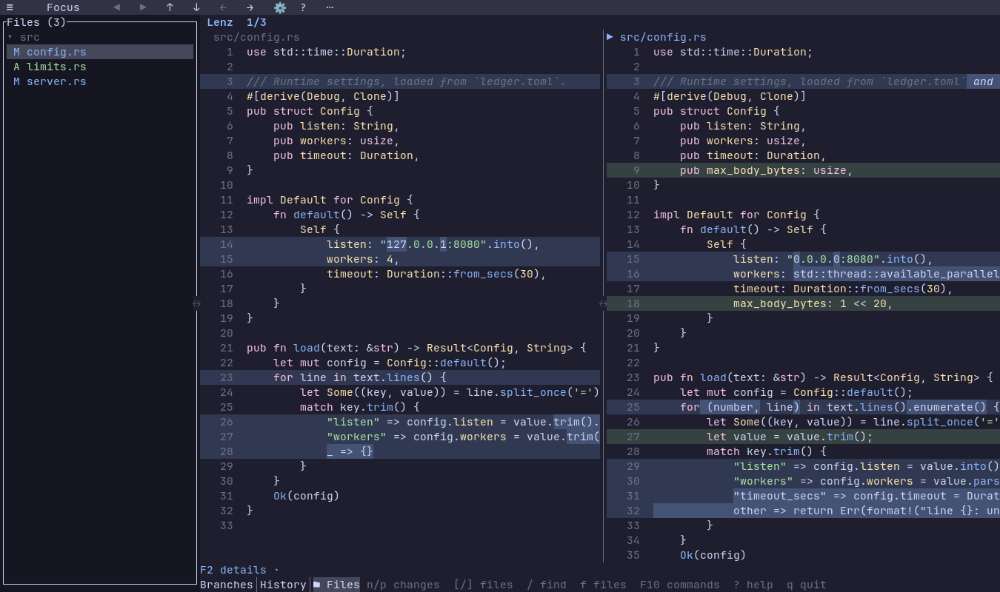

<p align="center">
  
</p>

<h1 align="center">Lenz</h1>

<p align="center">Read code, explore repositories, compare changes and resolve merges.</p>



A native code reader, diff viewer, git client and merge tool, built in Rust.
**Lenz Code** reads code; **Lenz Diff** compares and merges. Both have native
windows and terminal adapters. The desktop apps use [GPUI](https://github.com/zed-industries/zed);
the terminal uses [Ratatui](https://ratatui.rs) and has no GUI dependencies.

One `lenz` command opens both, each a separate executable:

| Command | Opens |
|---|---|
| `lenz [file-or-folder]` | Code Reader; with no path, the current folder |
| `lenz --tui [file-or-folder]` | Terminal Code Reader |
| `lenz diff …` | Desktop Diff |
| `lenz diff --tui …` | Terminal Diff |

`lenz-code`, `lenz-code-tui`, `lenz-diff` and `lenz-diff-tui` run an app directly with the same arguments.

**Upgrading from 0.0.1:** `lenz` now opens the Code Reader. Comparisons need the `diff` prefix
(`lenz diff left right`, `lenz diff log`, `lenz diff merge …`), `lenz-tui` is now `lenz diff --tui`
(or `lenz-diff-tui`), and git difftool and mergetool configurations change as shown in
[git difftool](#git-difftool) and [git mergetool](#git-mergetool).

**Status:** beta (0.0.5). Diff is tested on Linux and macOS (Apple Silicon), with automated
GUI interaction coverage on Linux. The Code Reader and the launcher are verified on Linux;
native macOS validation is pending. The Reader never edits files (Git checkouts you choose aside), with desktop and terminal adapters. See the [Diff macOS figures and known costs](docs/performance.md#macos).

## Screenshots

| Code Reader: project browsing and Find | Code Reader: Markdown preview |
|---|---|
| [](docs/images/reader-code.png) | [](docs/images/reader-markdown.png) |

| | Diff GUI | Diff terminal |
|---|---|---|
| **Repository** | [](docs/images/gui-repository.png) | [](docs/images/tui-repository.png) |
| **Merge** | [](docs/images/gui-merge.png) | [](docs/images/tui-merge.png) |
| **Compare** | [](docs/images/gui-markdown.png) | [](docs/images/tui-comparison.png) |

## Features

### Code Reader

- **Explore code** with a project tree, file finder, tabs, independent split panes,
  breadcrumbs, outline, folding and sticky declarations.
- **Navigate** with bookmarks, recent files and locations, and back/forward history.
  Installed language servers add definitions, usages, documentation, call/type
  hierarchies, semantic colours and inlay hints; availability depends on the provider.
  Dependency definitions reveal a lazy **Libraries** section for browsing their source files.
  F2 offers [project-scoped LSP settings](docs/code/providers.md#project-language-server-settings),
  including a reversible Ruby tooling-gem exclusion toggle and a reset to inherited settings.
- **Find** within a file or across the project, with case, whole-word and regular-expression
  options. Go straight to a file and line with `Ctrl+P`, or a line with `Ctrl+G`.
- **Read** syntax-highlighted text, images and rendered Markdown. Toggle source/preview
  with `Ctrl+Shift+V`, soft wrap with `Alt+Z`, and search with `Ctrl+F`.
- **Share appearance** with Diff: theme selection, custom themes and desktop font
  preferences. Each app keeps its own documents and navigation state.

The Reader does not edit the files it displays; only the checkouts and branches you choose change your repository. Archive browsing is currently a
Diff feature. See the [Reader guide](docs/code/README.md) for controls and limits,
and [language-server compatibility](docs/code/providers.md) for setup and provider side effects.

### Diff and merge

- **Compare** files, directories, revisions, the index or the working tree, with word/character/line highlighting, whitespace and case modes, three scroll modes, syntax highlighting, sticky scroll (the enclosing declarations stay pinned at the top of each pane) and blame annotations.
- **Apply changes**: move Change Blocks with ≫ / ≪ and revert hunks. Changes stay as a draft until you save. Every applied change stays visible as Applied or Undone, with selective Undo.
- **Browse** the repository: commit log with branch graph, file history (`--follow`), Change Set search and read-only GitHub pull requests with descriptions and review threads.
- **Merge**: a three-way Merge View, a Conflict List for whole merges/rebases/cherry-picks, and a Version Picker for binary files. The Merge View applies every non-conflicting change as soon as it opens and never drops a conflict.
- **Images**: two-up, swipe, onion skin and difference modes, with zoom and opacity.
- **Archives as folders**: a changed `.zip` or tarball (`.tar`, `.tar.gz`/`.tgz`, `.tar.bz2`, `.tar.xz`, `.tar.zst`) is listed as a folder of the files that changed inside it, each with its own comparison. Archives inside archives open too. RAR is shown as a binary file.
- **Folders**: a folder heading in Files collapses and expands with its arrow; archives start collapsed with their file count. A click on a folder's name shows its **Folder Summary**: the folder's changed files with the lines each added and removed.
- **Markdown Preview**: an Obsidian-like reading view (callouts, properties, highlights, tags, wiki links, footnotes, local images), Inline with removed words struck in place or Side by side, with change bars beside each changed block; every source change stays reachable. The terminal app shows it too, with images as real pixels in kitty and Ghostty.
- **Themes**: 16 bundled dark/light palettes, including Nord, Everforest, Kanagawa, Dracula, One Dark, Rosé Pine, Flexoki and Solarized; system/Omarchy following and custom TOML themes. See the [theme list](docs/themes.md).
- **Safe writes**: atomic, keeping encoding, BOM, line endings and file mode, and never over a file that changed on disk since Lenz read it.

## Install

Builds for macOS (Apple Silicon) and Linux (x86_64, aarch64) are on the [GitHub Releases page](https://github.com/aantoniadis/lenz/releases); the current one is a beta.

- **Homebrew** (macOS arm64, Linux): `brew install aantoniadis/lenz/lenz`, from the tap's formula (`packaging/homebrew/lenz.rb`).
- **Arch Linux**: `packaging/aur/PKGBUILD` builds `lenz-bin` from the release tarball: `curl -LO https://raw.githubusercontent.com/aantoniadis/lenz/main/packaging/aur/PKGBUILD && makepkg -si`. It will be submitted to the AUR as `lenz-bin` once account registration there reopens.
- **Tarball**: `lenz-<version>-<target>.tar.gz` from the [releases](https://github.com/aantoniadis/lenz/releases) holds `lenz`, `lenz-code`, `lenz-code-tui`, `lenz-diff`, `lenz-diff-tui`, this README and the licences; put the five executables on your `PATH`, together. On macOS they are inside `Lenz.app` (so the Dock shows its icon), with a symlink into it for each: keep them with the bundle, or link to `Lenz.app/Contents/MacOS/<name>`.
- **From source**: build the release package with `packaging/package.sh <version>` and put the five executables from `target/package/lenz-<version>-<target>/` on your `PATH`; see [Build](#build) for the system libraries.

Every package installs all five executables; `lenz` finds the others beside it. Linux binaries need glibc 2.35 or later; the GUI also loads the system's libxkbcommon-x11, libxcb and Vulkan loader at runtime (Debian/Ubuntu: `libxkbcommon-x11-0 libxcb1 libvulkan1`), which desktop installations already have.

Linux tarballs include the logo and two desktop entries, **Lenz Code** (`lenz.desktop`) and **Lenz Diff** (`lenz-diff.desktop`, which opens the repository chooser described below); the AUR and Linux Homebrew packages install them.

## Build

Needs a stable Rust toolchain and git 2.30 or later at runtime.

### Command family

With the system libraries listed below, build every app and stage the five commands together:

```sh
scripts/try-launcher.sh
target/launcher-trial/lenz path/to/project
target/launcher-trial/lenz path/to/source.rs
target/launcher-trial/lenz --tui path/to/source.rs
target/launcher-trial/lenz diff --no-index left.txt right.txt
target/launcher-trial/lenz diff --tui --no-index left.txt right.txt
```

The script prints the staging directory (which may differ with a custom Cargo target directory).
It installs nothing globally. Cargo's build names differ from the installed ones: `lenz-launcher` is `lenz`,
`lenz-reader` and `lenz-reader-tui` are `lenz-code` and `lenz-code-tui`, and Diff's `lenz` and `lenz-tui` are
`lenz-diff` and `lenz-diff-tui`. To build only the Reader, use `cargo build --release --locked -p reader-gui`
and run `target/release/lenz-reader`.

### Diff binaries

```sh
cargo build --release --locked -p lenz       # GUI: target/release/lenz
cargo build --release --locked -p lenz-tui   # TUI: target/release/lenz-tui
```

On Linux, gpui needs: `libxkbcommon-x11-dev libwayland-dev libfontconfig-dev libx11-xcb-dev libvulkan1 libglib2.0-dev libzstd-dev` (Debian/Ubuntu names). On macOS, full Xcode with the Metal toolchain (`xcodebuild -downloadComponent MetalToolchain`).

### macOS app bundle

`cargo build` makes bare executables. They work, but the Dock shows a generic icon while they start and quit, and the Lenz logo only once the window is up. For the logo throughout, build the release package, which puts all five executables in `Lenz.app`:

```sh
packaging/package.sh 0.0.5
```

The bundle is at `target/package/lenz-0.0.5-aarch64-apple-darwin/Lenz.app`, next to a symlink into it for each executable; the same folder is packed as `target/package/lenz-0.0.5-aarch64-apple-darwin.tar.gz`. `cargo build` does not update it: run the script again after changes. The argument is the bundle's version (Finder's Get Info) and goes into the file names; About shows the workspace version. It builds in `/tmp/lenz-dist` (set `CARGO_TARGET_DIR` to choose another folder outside your home): the shaders record their build folder, and no home folder may ship.

```sh
open target/package/lenz-0.0.5-aarch64-apple-darwin/Lenz.app                          # the Reader, as from Finder
target/package/lenz-0.0.5-aarch64-apple-darwin/lenz diff path/to/left path/to/right  # a comparison
```

To install it, copy `Lenz.app` to `/Applications` and put symlinks to the five executables in `/Applications/Lenz.app/Contents/MacOS/` on your `PATH` (as the Homebrew formula does); launched through them, from a terminal or as a git difftool, it still shows the logo.

## Usage

This is Diff's reference; Reader usage is in the [Reader guide](docs/code/README.md).
`lenz diff --tui` (the terminal) takes the same arguments as `lenz diff`, and `lenz-diff` and
`lenz-diff-tui` take them without the prefix. The git grammar mirrors `git diff`:

| Command | Shows |
|---|---|
| `lenz diff` | working tree vs index (unstaged changes), plus untracked files |
| `lenz diff --staged` (or `--cached`) | index vs HEAD |
| `lenz diff <rev>` | working tree vs `<rev>`, plus untracked files |
| `lenz diff A B`, `lenz diff A..B` | revision `A` vs revision `B` |
| `lenz diff A...B` | merge base of `A` and `B` vs `B` |
| `lenz diff ... -- <path>...` | only these paths (relative to the current directory) |
| `lenz diff <left> <right>` | two files, or two directories paired by relative path (inside a repository, the files git lists, submodules and nested repositories included, ignored ones skipped; `.git` never compared) |
| `lenz diff --no-index <left> <right>` | the same, even if an argument names a revision |

Browsing the repository:

| Command | Opens |
|---|---|
| `lenz diff log [<rev>...] [-- <path>...]` | the Repository Window: sources sidebar, commit log with branch graph, the picked Change Set below |
| `lenz diff log --follow <file>` | one file's history |
| `lenz diff pr [<number>\|<url>]` | a GitHub pull request, read-only (needs `gh`, run inside a clone) |
| `lenz diff` in a repository without changes | the Repository Window on HEAD |

In the Repository Window, a branch's right-click menu checks it out (a remote branch as a local branch tracking it), makes **New Branch from Here…** or compares it with the current branch; a tag's checks it out on a detached HEAD; another worktree's **Compare with Working Tree** compares the two folders. The command palette adds **New Branch…**, **Checkout Tag or Revision…** and **Show Changes Since Branch Start** (the working tree against where the current branch split from `main`, `master` or the remote's default branch). Local changes go along when git allows; otherwise **Smart Checkout** stashes and restores them and **Force Checkout** discards them after a second confirmation; untracked files in the way must be moved first. Unsaved edits in Lenz Diff must be saved or discarded before a checkout. Checkouts run git as your terminal would, hooks and filters included; nothing else does.

Resolving conflicts:

| Command | Opens |
|---|---|
| `lenz diff merge [<path>...]` | the Repository Window on the **Conflict List** of the merge, rebase, cherry-pick, revert or stash pop in progress (plain `lenz diff` does too while one is) |
| `lenz diff merge <base> <local> <remote> <merged>` | one file in the **Merge View** (what `git mergetool` runs); works outside git too |

Diffs given on the command line (and `git difftool`) open with the branches and history hidden (Files shows when there is more than one file); Esc shows the picker. **Focus** (the toolbar button, `f`, Enter in the log, or a double click on a commit) hides Branches and History, leaving Files and the diff; Focus again or Esc restores them. Two arguments are compared as plain files when both exist on disk and neither names a commit. In directory mode, byte-identical files at different paths are shown as renames.

Options:

- `--no-untracked`: hide untracked files.
- `--name <label>`: label for a single Comparison (may be empty).
- `-w`, `--ignore-all-space`; `--whitespace=default|trim|ignore|ignore-chunks`: starting Whitespace Mode.
- `-i`, `--ignore-case`: start with Ignore Case on.
- `--highlight=word|char|line`: starting Highlight Level; `--scroll=shared|aligned|padded|independent`: starting Scroll Mode (Aligned keeps matching lines level while each side scrolls its own lines; Independent never moves the other side).
- `--blame`: start with Blame Annotations on; `--line <n>`: open the first file at line `n` of the right Side.
- `--about`: show version, platform and licence information without opening a comparison.

**Outside a repository**, `lenz diff`, `lenz diff log`, `lenz diff merge` and `lenz diff pr` (and the same in `lenz diff --tui`) open a repository chooser instead of failing: recent repositories (those Lenz has saved a place for), a path field with Tab completion, and in the GUI **Browse…** (Ctrl+O) for the system folder dialog. Choosing one reruns the same command inside it; Esc quits with exit code `0`. Two files or folders still compare anywhere.

Lenz stays in the foreground until its window closes. Exit codes: `0` on a normal close, or when there is nothing to show (it prints `no differences` and opens no window); `2` on bad arguments or startup errors (git missing or older than 2.30, `lenz diff --tui` outside a repository without an interactive terminal). `lenz diff merge <base> <local> <remote> <merged>` exits `0` only after **Done**, `1` when cancelled or closed, so `git mergetool` restores its backup.

### Settings and last position

An optional `~/.config/lenz/settings.toml` (or `$XDG_CONFIG_HOME/lenz/settings.toml`) sets defaults for both frontends. Lenz reads it at startup; **☰ → Settings…** opens it in your editor, first creating it with every option commented out when there is none. A bad value falls back to its default with a notice. Command-line flags and environment variables (`LENZ_EDITOR`, `VISUAL`/`EDITOR`, `LENZ_ICONS`, `LENZ_LOG_DIR`) win over it.

```toml
[gui]
font_family = "JetBrains Mono"   # default: first installed of a built-in monospace list
font_size = 13                   # 8–32

[view]                           # starting options of each new comparison
whitespace = "default"           # default | trim | ignore | ignore-chunks
ignore_case = false
highlight = "word"               # word | char | line
scroll = "shared"                # shared | aligned | padded | independent
blame = false
markdown = "source"              # source | preview
markdown_layout = "inline"       # inline | side-by-side (Preview)

[tools]
editor = "nvim --clean"
icons = "plain"                  # nerd (default) | plain (TUI)
crash_dir = "~/lenz-crashes"

[session]
restore_place = true
```

Plain `lenz diff` and `lenz diff log` in a repository reopen where you left off: the selected commit, the file and the line. Anything that no longer exists falls back to the normal start, and a merge or rebase in progress always opens its Conflict List. Explicit comparisons, `lenz diff pr`, `lenz diff merge`, difftool and mergetool always open what they name. Positions are kept privately in `~/.local/state/lenz/places/`; set `restore_place = false` to turn this off.

### In the window

- `?` lists every key binding. The command palette (Ctrl/Cmd+Shift+P, F10, `:` in the diff, or the **Commands** hint at the bottom right; `⋯` in the TUI) lists every action; type to filter, and an unavailable one shows why.
- The toolbar keeps the frequent actions, with diff options under **⚙** and app actions under **☰**; Branches, History and Files toggle from the bottom bar; the diff header switches Markdown and image modes. Right-click shows only actions for what is under the pointer.
- Tab/Shift-Tab move focus between panes. Typing in the Files or Commits list searches it; Ctrl/Cmd+F searches the focused text side, Ctrl/Cmd+Shift+F the whole Change Set.
- **Back / Forward** (◀ ▶, Alt+Left/Right, mouse back/forward buttons) return to the previous commit, branch, filter or file history and reopen its file and line; `[` / `]` move between files.
- In **Focus**, commit details sit below the file tree and diff in a full-width panel. **Commit** in the bottom bar, or **Show / hide commit message** in Commands, hides and restores it. Files can be hidden independently.
- Drag pane dividers to resize; **Reset pane sizes** restores the layout.
- `o` opens the file in your editor at the line (`$VISUAL`/`$EDITOR`, or `LENZ_EDITOR` when those are wrappers), `shift-o` in the default app.
- Long histories load in steps of about 50,000 commits beyond what you can see; scrolling, End, searches and filters load more.
- In a pull request, **PR details** (`d`) shows the description, discussion, review summaries and inline review threads.

The terminal frontend has the same toolbar, menus and palette, with terminal-specific keys (`:` or F10 commands, Alt+0 Focus, F8 switches independent views, F6 moves between panes, Ctrl-Q quits). Clipboard uses OSC 52 and images render as terminal cells. See [terminal controls and capability limits](docs/tui.md).

### Terminal icons (Nerd Fonts)

Both terminal apps (`lenz --tui` and `lenz diff --tui`) show file-type icons by default. They are [Nerd Font](https://www.nerdfonts.com/) glyphs, so the terminal needs a Nerd Font, ideally a **Mono** variant so each icon takes one cell. Without one you see boxes or question marks. Lenz never installs fonts. Any Nerd Font Mono works; JetBrainsMono is used below.

1. Install the font:

   ```sh
   # macOS (Homebrew)
   brew install --cask font-jetbrains-mono-nerd-font

   # Arch Linux
   sudo pacman -S ttf-jetbrains-mono-nerd

   # Other Linux: from the Nerd Fonts release
   mkdir -p ~/.local/share/fonts/JetBrainsMonoNerd
   curl -fLo /tmp/JetBrainsMono.tar.xz https://github.com/ryanoasis/nerd-fonts/releases/latest/download/JetBrainsMono.tar.xz
   tar -xJf /tmp/JetBrainsMono.tar.xz -C ~/.local/share/fonts/JetBrainsMonoNerd
   fc-cache -f
   ```

2. Select **JetBrainsMono Nerd Font Mono** as your terminal's font, then restart the terminal:

   | Terminal | Setting |
   | --- | --- |
   | Ghostty | `font-family = "JetBrainsMono Nerd Font Mono"` in `~/.config/ghostty/config` |
   | Kitty | `font_family JetBrainsMono Nerd Font Mono` in `~/.config/kitty/kitty.conf` |
   | Alacritty | `[font.normal]` then `family = "JetBrainsMono Nerd Font Mono"` in `~/.config/alacritty/alacritty.toml` |
   | WezTerm | `config.font = wezterm.font("JetBrainsMono Nerd Font Mono")` in `~/.wezterm.lua` |
   | foot | `font=JetBrainsMono Nerd Font Mono:size=11` in `~/.config/foot/foot.ini` |
   | iTerm2 | Settings → Profiles → Text → Font |
   | Terminal.app | Settings → Profiles → Text → Font → Change… |

3. Check: `fc-list | grep -i "JetBrainsMono Nerd Font Mono"` on Linux lists it, and file names in `lenz --tui` show their icons.

To turn icons off:
- **Lenz Code:** **File Icons** in the View menu (remembered).
- **Lenz Diff:** the ☰ toggle, or `icons = "plain"` under `[tools]` in the [settings file](#settings-and-last-position).
- **Either, for one run:** `LENZ_ICONS=plain`.

### Editing and saving

Editable text comparisons keep **Undo**, **Redo** and **Save** directly accessible, with **Discard unsaved changes** in the Edit menu. Hunk moves stay pending until **Ctrl/Cmd+S** (Ctrl-S in the TUI comparison pane). **Revert hunk** restores the left version on the right working-tree side. Drafts survive file switches and repository refresh, and Lenz asks before closing or changing comparisons with unsaved drafts.

**Discard file** is a separate confirmed Git action: it restores the index version, preserves staged changes, restores tracked deletions, and offers **Undo Git discard**.

A click on a folder heading's ▾/▸ arrow collapses or expands it, and a click on its name shows the Folder Summary in place of the comparison. In Files, the arrow keys walk files and headings like a tree: on a heading Left collapses and Right expands it, and Left on a file moves to its folder's heading. In the summary, Enter opens the selected file, Left/Right collapse or expand the folder, and Esc returns to the file behind it. `]`/`[` and n/p skip files in collapsed folders. The command palette has **Show folder summary**, **Collapse folder**, **Expand folder**, **Expand all folders** and **Collapse all archives**. An archive starts collapsed; once you expand one it stays expanded while you browse other commits. Line counts are computed in the background, a few files at a time, as `git diff --numstat` counts them; binary files show their sizes and files over 20 MiB say "large file".

Files inside an archive are read-only: Apply, Revert hunk and Discard are refused with the reason, and **Show file history** follows the archive itself. Lenz reads archives in memory and never extracts them to disk. Members are compared by size and CRC-32 (zip's own record). An archive over 512 MiB, or one that cannot be read, stays one binary file with a note saying why. So does one whose files are all unchanged and only its packing differs.

### Merging

In the **Merge View** the Result starts from the Base with every non-conflicting change applied. Resolve each red **Conflict** with ≫ (Ours), ≪ (Theirs) — both, in the order clicked — or ✕ (keep the Base), or the keys `alt-shift-→ ← ↓ backspace`. **Resolve simple conflicts** (in the command palette) resolves Conflicts whose edits don't overlap word by word. `ctrl-s` saves; Conflicts left are written as git conflict markers in your `merge.conflictStyle`, with both versions kept, so saving early never loses a change. `ctrl-enter` is **Done**. Binary files open in the **Version Picker**: take one version whole. **Reopen conflict** resets an individual resolution.

git runs the merge tool once per file; `lenz diff merge` instead opens one window on every conflict (text, binary, deleted, symlink, submodule) with **Mark resolved** for each file.

### What Lenz writes

Only the files you act on: a Merge View's Result when you save, a whole version taken in the Version Picker, a text draft when you save it. Lenz stages only when you press **Mark resolved** (`git add`, or `git rm` for a deletion; **Re-open** restores the conflict markers), and never commits, checks out, continues or aborts a merge or rebase. Besides that: a pull request's objects under `refs/lenz/pr/*` (removed on exit) and, if you choose Speed up history, git's commit-graph file.

### Crash reports

A panic saves a local diagnostic report. **Report last error** in either command menu, or `lenz diff report --last` / `lenz diff --tui report --last`, opens an editable GitHub issue draft; `--print` shows the report location and link instead. The draft holds metadata only and uploads nothing. See [crash reporting](docs/crash-reporting.md).

## git difftool

```sh
git config --global diff.tool lenz
git config --global difftool.lenz.cmd 'lenz diff --name "$MERGED" "$LOCAL" "$REMOTE"'
git config --global difftool.prompt false
```

Prefer `git difftool -d` (for example `git difftool -d main...HEAD`): it opens one window for the whole Change Set instead of one window per file. Use `lenz diff --tui` in place of `lenz diff` for the terminal frontend. Configurations from 0.0.1 that run plain `lenz` open the Code Reader instead; add `diff`, or run `lenz-diff` directly.

## git mergetool

```sh
git config --global merge.tool lenz
git config --global mergetool.lenz.cmd 'lenz diff merge "$BASE" "$LOCAL" "$REMOTE" "$MERGED"'
git config --global mergetool.lenz.trustExitCode true
git config --global mergetool.prompt false
git config --global mergetool.keepBackup false   # optional: Lenz writes atomically, so the .orig files are just clutter
```

## Performance

The [final Linux validation on 2026-10-21](docs/release-validation.md) passed the
full suite: **133 cases, 394 metrics**, plus ten live language-server lifecycle
checks. Fresh paired runs measured Reader wheel feedback at **26.00→26.01 ms**
and Rails recovery after lost watcher events at **6.79→0.95 seconds**. The report
records startup, memory, stress, collector corrections and remaining native macOS
checks. The measurements below retain their original fixtures and endpoints.

### Code Reader

Linux release build on a private Xvfb display with Mesa software rendering;
generated Rust files, language servers disabled. Startup measures the first content-frame
marker, before GPU presentation and without waiting for syntax highlighting.

| Measurement | Result |
|---|---:|
| Open a 2,000-line Rust file, warm Reader cache (20 launches) | 153 ms median · 156 ms p95 |
| Same file, fresh Reader cache (20 launches) | 152 ms median · 156 ms p95 |
| Ten kept tabs, 20,000 source lines total | 164 MiB settled RSS · 164 MiB peak RSS |

The warm OS page cache and shader cache were retained in both startup cases;
"fresh" means an empty Reader cache. Memory covers the Reader process, not language
servers or GPU allocations. See [Reader measurements](docs/code/performance.md) for
raw samples, fixture details, reproduction and limits.

The integrated terminal reader opened 100,000 plain-text lines in 6.76 ms median
(seven launches), with 0.50 ms median page feedback and 35.9 MiB RSS after a
60-second navigation run. Timings end at PTY bytes, and RSS excludes GPU and
language-server memory. See [Reader TUI verification](docs/code/tui-performance.md)
for the standalone comparison, raw evidence and unverified workloads.

Lazy library browsing revealed a 1,000-file library in 0.811 ms in the shared core, leaving an unopened
10,000-file subtree unread. Paired GUI RSS was 168.78→168.88 MiB; this is a Linux software-rendered sample,
not a native macOS guarantee. See [library browsing validation](docs/code/performance.md#dependency-libraries-in-the-explorer--2026-10-21)
for startup, interaction, cancellation, memory and test limits.

### Diff and merge

Linux desktop, release builds, medians of three warm launches; the GUI on a software-rendered private X display, the TUI in a 120×36 pseudo-terminal:

| Operation | GUI | TUI |
|---|---:|---:|
| Open a small text comparison | 105 ms · 186 MiB | 8 ms · 10 MiB |
| Open a generated 100k-line comparison | 161 ms · 240 MiB | 28 ms · 55 MiB |
| Open two 4096×4096 PNGs | 187 ms · 706 MiB | 51 ms · 139 MiB |
| Open a 100k-line three-way merge | 249 ms · 307 MiB | 153 ms · 115 MiB |
| Open the repository log (500 commits) | 115 ms · 187 MiB | 7 ms · 10 MiB |
| Page Down in a 100k-line diff | 15.6 ms | 0.6 ms |
| Move through the repository log | 8.6 ms | 0.3 ms |

Opening times run to the GUI's first paint and the TUI's first comparison text; memory is RSS three seconds later (on macOS, the physical footprint). Interaction times are first feedback after the key, not a completed frame on a physical display. Syntax highlighting finishes after first content (0.5–0.9 s on 100k-line inputs in the TUI). On an Apple M2 Mac, GUI first paint is 231–401 ms; see the [macOS results](docs/performance.md#macos).

In a shared-core release fixture with 5,001 branches and 25 worktrees, incremental loading reduced first-comparison readiness from 114 to 10 ms and first-branch readiness from 105 to 35 ms (six samples). The sidebar initially retains 20 branches and offers **Load more**; worktree details finish in the background. These timings exclude frontend painting and GitHub access; see the [repository loading measurements](docs/optimization-notebook.md#2026-10-17-incremental-repository-loading-and-pr-reading).

The maintainer accepted about 7.5 MiB more settled GUI RSS and 0.05–0.07 seconds more startup CPU on the Linux software-rendered fixtures after checking the changes on Linux. Most extra repository RSS is one additional window-sized graphics allocation; hardware-rendered memory use remains unverified.

Reader/Diff sharing checks on this Linux experiment measured 35.8→35.1 ms to observe the Reader window, 36.3→37.3 ms for Diff, and 6.0→6.4 ms to TUI content (16 alternating pairs). These GUI endpoints precede first paint and cannot replace the table above. Timing repeats found no consistent regression; see the [shared-feature verification](docs/shared-features-performance.md) for memory, stress and limits.

The bottom commit-panel checks measured GUI alternating scroll feedback at 11.89→11.93 ms and TUI feedback at 0.486→0.451 ms. Hardware-rendered log first paint measured 137→134 ms; 15-minute GUI/TUI runs passed with comparable memory growth and matching GPU allocation plateaus. See the [panel verification](docs/commit-panel-performance.md) for startup, Find, memory, stress, and measurement limits.

The dependency refresh measured Reader GUI startup at 163.57→163.75 ms to the
first received client image and TUI content at 7.695→7.981 ms in alternating
release runs. Both full suites passed 75 cases. These startup endpoints differ
from the historical content-frame figures above; see the
[refresh measurements](docs/performance.md#dependency-refresh-2026-10-18) for
memory, repeated outliers and the slower image microbenchmark.

Reader theme-chooser parity measured GUI first client image at 157.02→154.04 ms,
menu feedback at 25.11→23.39 ms and RSS at 173.61→173.44 MiB in seven alternating
release pairs. See the [theme checks](docs/code/performance.md#theme-chooser-parity-2026-10-18)
for terminal measurements, actual input and short stress limits.

Reader toolbar/status checks repeated the GUI comparison at 157.35→159.47 ms
first client image and 24.13→24.40 ms menu feedback; TUI source receipt was
8.88→8.80 ms. Pair variation includes zero timing difference. Initial GUI RSS
rose slightly while sustained RSS settled below baseline in both rounds; see the
[chrome measurements](docs/code/performance.md#reader-chrome-parity-2026-10-18)
for the complete results and 60-second status/copy/resize checks.

Reader trackpad/progress checks measured first content at 126.78→126.65 ms in
four alternating release pairs, with comparable scrolling and memory during a
2,001-file Ruby project load. See the [scrolling checks](docs/code/performance.md#trackpad-scrolling-and-indexing-progress-2026-10-21)
for server setup, repeated measurements and unverified native macOS behavior.

Diff and Reader now share GUI wheel conversion and fractional-step handling. Final
release pairs measured wheel feedback at 27.04→27.23 ms for Diff and 25.53→26.11 ms
for Reader; see the [shared scrolling checks](docs/code/performance.md#shared-gui-wheel-input-2026-10-21)
for startup, repeated timing variation, memory, short stress and native-platform limits.

On a pinned large Discourse Rails checkout, optional project/tooling-gem exclusions reduced Ruby LSP 0.26.11
readiness from 13.20 to 10.67 seconds (19.2%) and peak combined core/server RSS from 748 to 648 MiB.
Project-file exclusions remain opt-in; tooling-gem exclusions now default on and can be disabled. See the [Rails indexing experiment](docs/code/performance.md#large-rails-indexing-experiment-2026-10-21)
for configuration, rejected approaches and the Linux-only measurement limits.
An [editor-practices follow-up](docs/code/performance.md#editor-lsp-practices-trial-2026-10-21) kept default
project-file coverage and excluded tooling gems only: readiness measured 13.33→11.94 seconds (10.4%), with one server
reused across 1,062 file switches in a 30-second shared-core check.
The implemented [project settings check](docs/code/performance.md#project-scoped-lsp-settings-2026-10-21)
measured default readiness at 13.86→13.78 seconds and the new binary's scoped tooling profile at 12.92 seconds
(6.2% below its defaults). The full local gate passed; native macOS remains unverified.

An isolated [persistent-index experiment](docs/code/performance.md#persistent-index-prototypes-2026-10-21)
made the complete local declaration index available in 7.89→0.49 seconds on reopening Discourse,
with Ruby LSP readiness at 14.45→13.55 seconds and sampled CPU time at 22.67→13.95 CPU-seconds.
Those were prototype measurements: combined startup peak RSS was 26.7 MiB higher;
metadata-only validation and simple Ruby gem-record replay failed correctness checks.

The shared [checkout recovery fix](docs/code/performance.md#checkout-and-watcher-recovery-2026-10-21)
now refreshes local declarations and Ruby LSP after directory changes or lost watcher events.
In a live Discourse A → B → A test, affected-directory declarations recovered in about 0.11 seconds;
simulated event loss required a full background rebuild of about 7.6 seconds. Default Ruby LSP startup
measured 12.83→12.61 seconds; this fixes stale results without introducing the experimental cache.

Saved declaration reuse and Ruby tooling-gem exclusions now have **On/Off** controls in F2 and the shared
command menu, alongside **Rebuild Project Index**. Both optimizations default on; explicit Ruby settings
take precedence. In the [implemented settings comparison](docs/code/performance.md#configurable-index-reuse-and-rebuild-2026-10-21),
reopening Discourse completed local declarations in **8.12→0.52 seconds**, Ruby LSP reached Ready in
**14.05→11.61 seconds**, and peak combined RSS measured **727→682 MiB**. First-time Ruby startup measured
**12.07 seconds**. Cache-only mode retained higher combined RSS; see the report for that tradeoff, frontend
repeats and unverified native macOS behavior. [Controls and settings](docs/code/providers.md#saved-declarations-and-rebuilding).

The [cross-language check](docs/code/performance.md#cross-language-index-validation-2026-10-21) covers all nine
other declaration grammars. On generated 1,200-file corpora, saved declarations complete in **21–23 ms**,
versus **164–347 ms** with reuse disabled (three samples per case). First-time cache creation adds **5–16 ms**.
Ten real-server scenarios pass definition, changed-content, rebuild and opt-out checks. These are local-index
timings and focused semantic checks; full language-server indexing and native macOS performance remain separate.

Further [isolated experiments](docs/code/performance.md#further-indexing-experiments-2026-10-21) reduce
content-validated overflow recovery **5.50→0.81 seconds**, but extra directory scanning regresses routine
updates. A lighter saved-index path improves isolated local indexing **250→237 ms**. A retained Ruby-server
helper reduces checked reconnect **12.33→0.96 seconds**, at about **699 MiB** idle residency. These prototypes
are recorded separately from the implementation below; the lighter cache path and retained-server helper
remain deferred.

The implemented [overflow recovery](docs/code/performance.md#content-aware-overflow-recovery-2026-10-21)
reuses existing background index reads to skip Ruby LSP notifications for unchanged contents. On Discourse,
three paired runs improve recovery through exact semantic checks **5.56→1.14 seconds** (about **4.9×**),
with ordinary directory updates **0.58→0.50 seconds**. The existing saved-index toggle disables this filtering,
and explicit rebuild remains available in both frontends. Cold server indexing remains around **11–12 seconds**;
the report includes repeat measurements, the small retained-digest memory cost and unverified native macOS behavior.

See the [performance overview](docs/performance.md) for method and accepted costs, and the [benchmark guide](docs/benchmarking.md) to run the suite yourself.

## Documentation

| Guide | Covers |
|---|---|
| [Code Reader](docs/code/README.md) | Navigation, search, splits, Markdown and language-server controls |
| [Terminal Code Reader](docs/code/tui.md) | Reader TUI controls and capability limits |
| [Command family](docs/launcher-trial.md) | How `lenz` dispatches to the four apps, migrating 0.0.1 commands, and the trial record |
| [Reader performance](docs/code/performance.md) | Startup and memory measurements, raw samples and limits |
| [Terminal frontend](docs/tui.md) | TUI controls, architecture and capability limits |
| [Markdown Preview](docs/markdown.md) | Source, Inline and Side by side views and source fidelity |
| [Themes](docs/themes.md) | Built-in themes, system following and the custom theme format |
| [Crash reporting](docs/crash-reporting.md) | Report locations, retention and issue drafts |
| [Performance](docs/performance.md) | Current GUI/TUI results, method and accepted costs |
| [Benchmark guide](docs/benchmarking.md) | Running and comparing the performance suite |
| [Optimization notebook](docs/optimization-notebook.md) | Techniques kept, rejected and still untried |
| [Release checklist](docs/release-checklist.md) | Packaging and the manual release walkthrough |
| [Design research](docs/research/README.md) | Initial toolkit, git, diff/merge, encoding and packaging research |
| [All docs](docs/README.md) | Index of the guides and design records |

## Contributing

Checks run locally: `scripts/ci-local.sh` runs clippy with warnings as errors, the panic-site ratchet, every test suite and the release size check (`--old-git` adds the git 2.30 tests in podman or docker). Enable it before every push with `git config core.hooksPath .githooks`. `python3 scripts/capture-screenshots.py --xvfb /path/to/Xvfb` regenerates the Diff screenshots (Catppuccin Mocha) on a private display. Add `--reader target/release/lenz-reader --only reader-code reader-markdown` to capture the Reader using disposable demo files.

## Licence

The app (`crates/app`) and its shared content crate (`crates/content`: decoding, line offsets, syntax highlighting, themes) are MIT; the diff engine (`crates/engine`) is Apache-2.0 and contains ported IntelliJ Community code (see its NOTICE). Darcula and Light follow IntelliJ's schemes (JetBrains, Apache-2.0); additional base colors adapt Omarchy and upstream editor palettes under MIT. See [theme attribution](docs/themes.md) and [third-party theme notices](LICENSE-THEMES).
