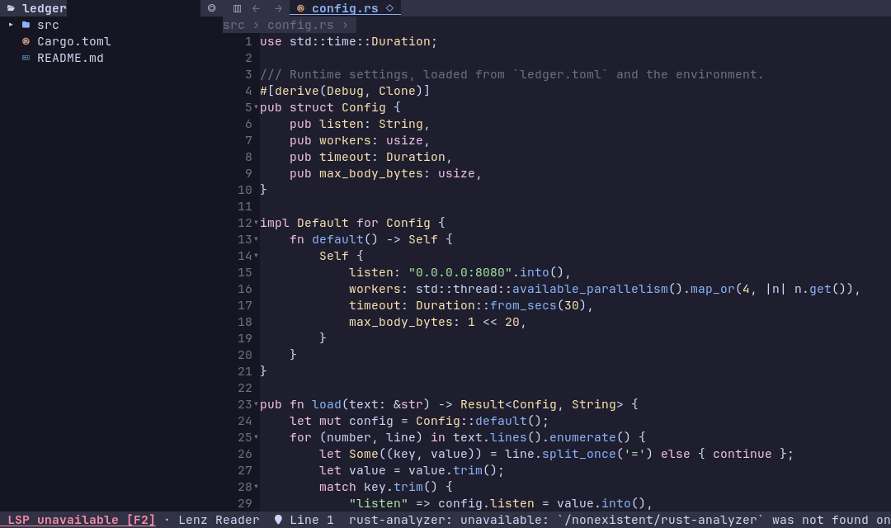

# Terminal reader



Lenz Code's terminal reader presents the same `reader-core` session as the GUI. Installed, run
`lenz --tui path/to/file.rs` or `lenz-code-tui` (see [the command family](../launcher-trial.md)).
Build the adapter separately so its executable
does not include GPUI, GPU or windowing dependencies:

```sh
cargo build --locked --release -p reader-tui
./target/release/lenz-reader-tui path/to/file.rs
./target/release/lenz-reader-tui path/to/folder
```

With no argument it opens the starting folder, except home and `/`, as the GUI does. `--help` and `--version`
work without a terminal; ordinary reading needs an interactive terminal on stdin and stdout. `--` permits a
path beginning with a dash. Opening a file alone does not enumerate its parent; Open Folder starts project
browsing and project search.

Reopening a directory restores its saved tabs, active file, caret and scroll positions, split panes and explorer
state through the same core as the GUI. Switching directories saves and replaces the workspace; closing a view
or quitting saves it too. Files load lazily and missing files are skipped. See [workspace persistence](README.md)
for limits and concurrent-window behavior.

Dependency definitions reveal the same lazy **Libraries** section as the GUI, including when no project folder
is open. Ctrl+Shift+E focuses the explorer; arrows expand or collapse folders and Enter opens a file. Collapse
and expand to refresh a listing. Server-retrieved sources list visited files only. See the
[Reader guide](README.md) for listing limits and server-session behavior.

Explorer rows and tabs show the file's Git status against HEAD as a letter: **M** modified (staged or not),
**A** added, **D** deleted from disk, **R** renamed, **U** untracked (a file inside an untracked folder too) and
**C** conflicted; the color is extra. `●` marks unsaved changes separately, so a draft over a Git-clean file shows
`●` and no letter, and Save leaves the letter to Git. Both adapters read the status in the background, once per
change: after the repository is found, on file changes, and when the index or HEAD changes (checked on the
five-second tick). Refreshing never touches drafts or history. At most 20,000 changed paths are read; folders show
only their own untracked status.

**Compare saved** (Ctrl+Shift+D, also in the palette) opens an in-window comparison against the last
confirmed saved version. **Last saved (read-only)** and **Current draft** show changed rows with a blue
background and `▌` gutter marks. The current side shares the ordinary tab’s buffer and undo history;
the saved side cannot be edited. **Close comparison**, Ctrl+F4 or Close Split restores the original views
without discarding the draft. Rejected or uncertain Save keeps the prior baseline. The panes scroll
independently. Platform input availability is described below; see the [implementation and verification limits](../research/reader-saved-comparison.md).

Opening a dirty file in an editor or default app offers **Save and Open** (`s`),
**Open Saved Version** (`o`) or **Cancel** (Esc). The saved-version choice keeps
the draft/history and omits dirty caret coordinates. Save and Open launches once
after confirmed Save; Cancel, stale decisions and failed/uncertain Save launch
nothing. An already requested Save can still finish after Cancel. External
comparison actions explicitly use saved disk inputs. See the
[handoff behavior and verification](../research/reader-external-open-decisions.md).

**New File** (Ctrl+N) opens an untitled document with its own history; it is never written, watched or
restored until **Save As…** (Ctrl+Shift+S, or Save on an untitled document) chooses a path. The terminal asks
for the path (relative paths resolve against the project); the GUI uses the platform save dialog. Save As
refuses missing folders, folders, broken links and files open in another tab, and an existing file needs
**Replace** (`r`) or **Cancel** (Esc) in a Lenz dialog; Replace writes only if that same file is still there.
A new file is created without replacing anything that appears meanwhile. The draft keeps its encoding, BOM
and exact line endings (UTF-8 without BOM when untitled). Only a confirmed write moves every view to the new
path; a rejected or uncertain write leaves the document, its original file and its Save state unchanged.
The original file and its bookmarks stay where they were.

The checkpoint23 candidate enables basic editor input by default on Linux TUI and Linux X11 GUI.
The GUI uses its actual backend identity; Wayland and native macOS stay gated. q/j/k/slash/Space type literally, bracketed paste is
one transaction, and Cut/Copy/Paste/Delete plus Undo/Redo use shared commands. **Read-only Mode** applies to
all views of the same buffer and cannot override intrinsic restrictions or enable writing. Terminal Paste
normally comes from the emulator (often Ctrl+Shift+V); the Paste command explains this route. See the
[basic-input report and limits](../research/reader-text-input.md).

**Editing Preferences…** (Find Action or the Selection menu, in both adapters) shows the active file's
indent style, indent size and tab width, each with its source: EditorConfig first, then the open project's
choice (**Project Indentation: Tabs / 2 Spaces / 4 Spaces / EditorConfig and Language Defaults**), then the
language default. It also names the formatter a project configures and where its executable was found;
resolution only reads files and never installs, upgrades or runs tools or environment files. **Format on
Save for This Project** is off by default and only remembered for now: Lenz does not format yet. Project
choices are saved in the Reader settings file, never in the project. EditorConfig `{n..m}` ranges are not
matched, and indentation commands that use these preferences are not available yet.

The terminal emulator owns input-method preedit; Lenz receives committed Unicode text and bracketed paste.
GUI preedit and both adapters' long-line edits use the bounded source-coordinate path; see the
[composition verification and limits](../research/reader-unicode-composition.md). The activation candidate
still awaits the combined correctness gate and performance acceptance.

**Code Completion** shows the language server's suggestions for the name at the caret. Typing a name (or a
server trigger character such as `.`) opens it unless **Completion While Typing** is off; Ctrl+Space asks
manually. Many terminals cannot deliver Ctrl+Space (some send NUL, which also works); **Code Completion** in the
F10 palette is the equivalent route. While the popup shows, Up/Down/Page Up/Page Down choose, Tab or Enter accept,
Esc dismisses and a click accepts a row; any other key, punctuation included, types normally and never accepts.
Acceptance is one undoable draft edit; suggestions carrying imports, snippets or server commands are listed but
refused whole. See the [completion behavior and limits](../research/reader-completion.md).

## Controls

F10 opens the command palette; `:` is an alias outside source input mode. Type to filter, use the arrows and Enter to run. It includes all shared
commands, their setting states and disabled reasons, including provider controls and features without a terminal
shortcut. F1 opens wrapped, scrollable help; F2 opens language-server status and recovery.
A dedicated toolbar above the tabs exposes Menu and frequent navigation/file/search actions.
The footer reserves separate language-server, message, cursor-position and Commands areas.
Long messages end with an ellipsis: click the message or press Shift+F2 for a wrapped, scrollable
status snapshot; Ctrl+C copies the full text through the terminal clipboard. Routine server-memory
samples stay in details. Narrow layouts keep actions available through F10. Esc dismisses a modal before underlying
controls can receive input. Reader modals also consume view-switching and quit keys. Ctrl-Q requests closure of the current independent view; F8 and Shift-F8 switch views. New Window
in the palette opens an independent terminal view. Ctrl-Shift-Q requests closure of all views in terminals that report it.
Before removing the last view of an unsaved draft, choose **Save** (`s`), **Discard** (`d`) or **Cancel** (Esc).
All-view closure prepares every session before removing any; Cancel keeps every view and draft. An earlier
explicit Save remains on disk even if another view cancels. Failed or uncertain Save cancels the pending close.
After an uncertain result, a fresh actual tab, split, window or all-view close offers **Discard Draft and Close**
without requiring a disk recheck. This discards the in-memory draft/history and leaves disk as it stands;
it never resumes the failed close or retries Save. Recheck remains available before deciding. Another Save
still requires **Recheck Saved File** and **Confirm Rechecked Save**; a changed disk result cannot be confirmed for Save.
Tab closure and Close Split keep a draft whenever another accessible tab still owns it.

Reload, changing folders/worktrees and checking out or creating-and-checking-out a branch use the same
Save/Discard/Cancel decisions. Their Discard decision after an uncertain Save still requires a successful
current-file recheck. The actual-close exception does not apply to Reload, project/Git transitions or external opens.
Cancel retains drafts and positions; earlier confirmed Saves remain written.
Failed or blocked Reload/checkout retains the draft and requires a fresh decision on retry. Watcher,
focus and index refresh retain drafts and undo history, with a visible notice when disk content changes
or becomes unavailable. Reload from a saved comparison's Current pane returns to the ordinary draft;
the Last saved pane remains read-only.

| Operation | Control |
| --- | --- |
| Search Everywhere / files / symbols / actions | Ctrl-K / Ctrl-P or Ctrl-Shift-N / Ctrl-Alt-Shift-N / Ctrl-Shift-A or Ctrl-Shift-P |
| Open file / go to line | Ctrl-O / Ctrl-G |
| New file / Save As | Ctrl-N / Ctrl-Shift-S (where the terminal reports it; also F10 → File) |
| Compare two explorer entries | Space on each (or Ctrl+click where the terminal reports it), then Ctrl+D; Esc forgets them |
| Open in editor / default app, compare with | File menu or right-click: Open in Editor, Open with Default App, Compare Saved Disk Inputs… (a typed path; Lenz Diff's terminal app runs in this terminal until it quits) |
| Find in file / next / previous | Ctrl-F or `/` / F3 / Shift-F3 |
| Find options | Alt-C / Alt-W / Alt-R in find or search |
| Search project / file pattern | Ctrl-Shift-F / Tab in search |
| Reload / close tab | F5 or Ctrl-R / Ctrl-F4 |
| Explorer visibility / focus | Ctrl-B / Ctrl-Shift-E |
| Focus tree, reading area and results | Shift-Tab; click a pane (Tab cycles outside source input mode; in editable source it inserts a tab) |
| Navigate tree or results | Arrows, PageUp/PageDown, Home/End; Enter opens |
| Move text cursor | Up/Down/Left/Right (Shift extends selection) |
| Scroll text | PageUp/PageDown, Home/End; wheel (j/k only while text input is gated) |
| Select / copy | Click or drag, double click word, triple click its syntax group, Shift-arrows, Ctrl-A / Ctrl-C |
| Git branches | Ctrl-\` (if your terminal sends it), F10 → Git, or click the branch in the status bar; type to filter, Enter checks out / opens a worktree, → or right-click for a row's actions; checkout problems: s Smart, f Force (f again to confirm), Esc cancels; new branch: Tab toggles Check out |
| Git comparisons | F10 → Git: Show Local Changes, Compare with Branch, Tag or Revision… (a list of branches and tags; type to filter or for any revision), Compare with Base Branch, Show Changes Since Branch Start, Compare with Worktree… (the other worktrees; Enter compares); a Git Branches row's → menu: Compare with Working Tree, Show Changes Since Branching from Here. Lenz Diff's terminal app runs in this terminal until it quits |
| Annotate with Git blame | Alt-B (View menu, right-click); click an annotation for its commit (d Show Diff, c Copy Revision); the status line shows the caret line's commit |
| Extend / shrink syntax selection | Ctrl-W / Ctrl-Shift-W |
| Next / previous tab | Ctrl-Tab / Ctrl-Shift-Tab |
| Split right / down; focus pane | Ctrl-\ / Ctrl-Shift-\; Ctrl-1 / Ctrl-2 |
| Back / forward | Alt-Left / Alt-Right |
| Horizontal scroll / reorder tab | Ctrl-Alt-Left/Right / Alt-Shift-Left/Right |
| Soft wrap / Markdown source-preview | Alt-Z / Ctrl-Shift-V |
| Collapse / expand; all folds | Ctrl-minus / Ctrl-equals; add Shift for all |
| Bookmark / key / list | F11 / Ctrl-F11 / Shift-F11 |
| Set / visit numbered bookmark | Ctrl-Shift-digit / Alt-digit |
| Recent files / locations | Ctrl-E / Ctrl-Alt-E |
| Outline / declarations | Ctrl-Shift-O / Ctrl-T |
| Definition / peek / usages | F12 / Alt-F12 / Shift-F12 |
| Type definition / implementations | Ctrl-Shift-B / Ctrl-Alt-B |
| Call / type hierarchy | Ctrl-Alt-H / Ctrl-H |

**Search Everywhere** has the same All / Files / Symbols / Actions scopes as the GUI. Type to fuzzy-match,
Tab / Shift+Tab changes scope while keeping the query, arrows/Page/Home/End select, Enter opens/runs and Esc
closes. Scope tabs and rows are clickable when they fit; narrow windows show the current scope and keep Tab
cycling. Results show their kind, path or action group, setting value, shortcut and disabled reason; only visible
rows are formatted. Long Unicode queries keep their typed tail and caret in view. Empty queries favor recent
files; file searches retain `name:line[:column]`. The shared core caps results at 100 and rejects stale replies
and clicks. Symbol search uses the project declaration index without requiring an LSP and reports its limits.

**Recent Files (Ctrl-E)** uses the same searchable rows, file icons and secondary paths, limited to files
already visited. Empty queries keep the previous file first for quick Ctrl-E, Enter switching; typing fuzzy-matches
names and paths. Delete forgets an entry without deleting its file. In popups, the wheel scrolls the viewport
without changing the selected option; keyboard navigation selects and reveals an option.

**Double Shift** also opens All when the terminal sends bare modifier press/release events through the enhanced
keyboard protocol. Reader requests these reports and restores the previous mode on exit. Legacy terminals,
multiplexers and SSH paths may omit them; **Ctrl-K** and the catalog's Search Everywhere always work. Shifted
typing, selection, held-key repeats and focus loss do not count as double Shift. Ordinary held arrows and query
characters continue to repeat. Ctrl-Shift-N now finds files; New Window remains in the command palette.

The toolbar's **☰ Menu** opens the same dropdown as the GUI's ☰ button: the File, View, Navigate, Find, Selection
and Language Servers groups, Change theme, About Lenz Code and All commands…; Enter or → opens a group, ← or Esc goes back, and a
disabled command's reason shows in the footer. The F10 palette labels commands with the same groups; type a group
name followed by `:` to filter that group. The GUI additionally has a clickable
Commands button in its status bar; the terminal keeps F10 / Ctrl-Shift-P access to the same catalog.

The toolbar follows the GUI: explorer toggle, Back/Forward, SVG Source/Image, Find file and Search (Open is in the File menu and on Ctrl-O).
Markdown's **Preview / Source** button sits at the right edge of its file header; each split pane controls its
own document, focusing that pane before switching. The explorer title has Select Opened File. Narrow panes omit controls that do not
fit; every action remains available through F10. Left-click selects source text; right-click in either reading
pane opens the same contextual command list as the GUI, with shared availability and separators. Clicking
outside a menu dismisses it without acting on the document underneath.

The footer keeps a clickable LSP status before paths and notices. Click it, press F2, or choose **Language Server
Status…** in F10 for the compact actions menu. Choose **Server Details…** for the full error, setup guidance,
project settings and indexing context. Its clickable **Copy** and **Close** controls stay visible while scrolling;
Ctrl-C copies the full, unwrapped snapshot through OSC 52, and Esc closes it. Reopen the popup to refresh its
contents. **Copy Language Server Details** remains in F10. The menu offers Restart, Enable/Disable for This
Folder and Set Workspace Root with shared disabled reasons. Recovery actions stay in fixed positions while
background status changes. Missing servers need user installation or an executable/PATH correction; restarting
rechecks setup. Disabled servers stay off until explicitly enabled. Unsupported documents explain that no server
is available; text search and syntax highlighting remain usable. See [provider setup](providers.md#status-and-recovery).

F2 and the Language Servers command group also offer **Exclude Ruby Tooling Gems for This Project** and
**Reset LSP Settings for This Project**. These use the resolved server workspace, save outside the checkout,
and restart only the affected provider/workspace. Exclusions default to On and reduce navigation into tooling
gems; toggle them Off to restore that coverage without clearing unrelated settings. Reset restores inherited settings for that provider/project. See [project settings](providers.md#project-language-server-settings)
for JSON overrides, precedence and legacy Ruby `.index.yml` handling.

The same menu offers **Reuse Saved Declaration Index: On/Off** (On by default) and **Rebuild Project Index**.
Rebuild discards the current project's saved declarations, refreshes open documents and restarts its language
servers while rebuilding local symbols. Both controls also appear in F10 and Find Action. See
[cache and rebuild controls](providers.md#saved-declarations-and-rebuilding) for settings and limits.

The finder accepts `name:line[:column]`. Go to line accepts `line`, `line:column` or `line,column` and reports
invalid input. Find updates while typing; Enter leaves its matches available for F3, while Esc closes find.
Project search supports the same file globs, options, streamed results and cancellation as the GUI. Result
selection previews a snapshot; Enter validates and opens it. Left/Right fold result groups and hierarchy levels;
the palette changes hierarchy direction. Mouse and keyboard selection copy source bytes, including hidden folded
lines, without changing the source. A caret without a selection copies its source line.

## Presentation and terminal limits

Syntax and semantic colors, inlay hints, find and occurrence highlights, folds, sticky lines, breadcrumbs,
bookmarks, split panes, image rendering and Markdown previews consume the shared state. Markdown uses the shared
parsed blocks, inline styles and validated local images. Its rendered selection copies rendered text through the
core's Copy Text command. An SVG can switch between image and source. Images use true-color half-block cells; Markdown images fit the width and at most 20 terminal rows, without upscaling.
The terminal controls fonts, cell aspect ratio and support for italic, underline and strike. These are display
limits rather than different document behavior.

Nerd Font glyphs decorate the command bar, explorer, tabs, search results heading and status bar by default,
as in the comparison TUI. **File Icons** in the View menu turns them off (and on again); the choice is
remembered and shared with the GUI reader, which then hides its file icons too. `LENZ_ICONS=plain|nerd`
overrides it for one run, until File Icons is toggled. Configure a [Nerd Font Mono](https://www.nerdfonts.com/)
in your terminal, for example JetBrainsMono Nerd Font Mono, so icons occupy one cell; fonts are never installed
or changed by the app. Active reading tabs use
bold accent text and an underline when focused; pane headings and rounded dialogs follow the selected theme.
Files use the GUI reader's file-type glyphs and colors, including special names such as `Cargo.toml`,
`Dockerfile` and `.gitignore`. Folder icons distinguish open and closed directories.

`NO_COLOR` disables **all** terminal colors, including syntax and diff highlighting. If the entire app is
monochrome, use `env -u NO_COLOR lenz --tui` with the staged launcher (or run
`lenz-reader-tui` directly). The app leaves your terminal and shell configuration unchanged.

**Change theme** is an application command in the F10 menu. Its chooser highlights the current selection and previews themes with arrows, Home/End and Page Up/Down. Enter or a click saves the choice; Escape or an outside click cancels the preview. The wheel scrolls the list without changing the highlighted theme.

Themes use the shared Lenz configuration: `lenz/appearance.json` and `lenz/themes` under
`$XDG_CONFIG_HOME`, with `LENZ_THEME` taking precedence over `LENZ_APPEARANCE` and the legacy
Reader environment variables. Explorer order, wrap, sticky scroll, semantic settings, split orientation and saved
places use the GUI's `lenz-reader` configuration and state directories. See [Themes](../themes.md)
for precedence and compatibility fallbacks. Follow system falls back to a dark palette
when the shared theme service cannot detect appearance. There is no native file picker: Open File, Open Folder
and Workspace Root accept paths. Opening another view creates another session with its own documents and places;
it does not mirror a live document from a different view.

Clipboard transport is OSC 52: the terminal or multiplexer must permit it. Source text is base64 encoded before
entering the escape sequence. Legacy terminals cannot distinguish every Ctrl/Shift combination; use the palette
for any shortcut your terminal does not deliver. Pane dimensions are automatic, and mouse tab dragging and divider resizing are not implemented; tabs can be reordered
with the keys or moved between panes through the palette. Native GUI text shaping and operating-system primary selection
are not available in the terminal. The terminal restores raw mode, mouse/focus/paste reporting and the alternate
screen when it exits normally or returns an I/O error; an uncatchable process kill cannot run cleanup.

## Verification

```sh
scripts/ci-local.sh
cargo test --locked -p reader-tui --features gui-test parity_tests
python3 scripts/code-tui-bench.py --binary target/release/lenz-reader-tui \
  --out target/perf/reader-tui-check --lines 100000 --rounds 30 --stress-seconds 60
```

The local gate runs core tests, actual GPUI input tests, terminal event/render tests and a replay comparing both
adapters' semantic state and source bytes. The `gui-test` feature is for combined tests; leave it off the
standalone TUI build. The PTY collector generates disposable documents, isolates settings, checks normal/error
cleanup, input and modal behavior, copy, refresh, independent views and tiny resizes. It retains raw terminal
output, source/executable identity, timing samples, memory samples and actual stress duration.

PTY timings end at bytes received by the collector; they do not measure a terminal emulator's display latency.
Linux RSS includes allocator residency and excludes child language servers; macOS collection uses resident size,
not physical footprint. Neither memory samples nor one stress run prove the absence of leaks. Native macOS,
physical-terminal appearance, authenticated or installed language-server combinations beyond the existing provider
tests, and long sessions remain separate acceptance checks. The [workspace integration measurements](tui-performance.md)
record current startup, interaction and stress checks; the imported [performance record](performance.md)
describes historical Reader measurements with different workloads.

For a Java server runtime failure, F2 → **Choose Language Server Runtime…** offers installed executables and a path/JDK
home field. Save validates the executable, persists the override and restarts enabled Java servers; Escape
before saving cancels. The GUI exposes the same commands. See [provider runtime repair](providers.md#repairing-a-java-server-runtime-in-the-reader)
for validation and installation limits.


Python failures use the same runtime dialog to choose an existing Node.js installation containing Pyright.
F2 shows the detected/tested server version, bounded launch log and selected runtime version when available;
**Copy Language Server Details** copies the same diagnosis. See [version context and runtime repair](providers.md#version-context-and-pyright-runtime-repair).
