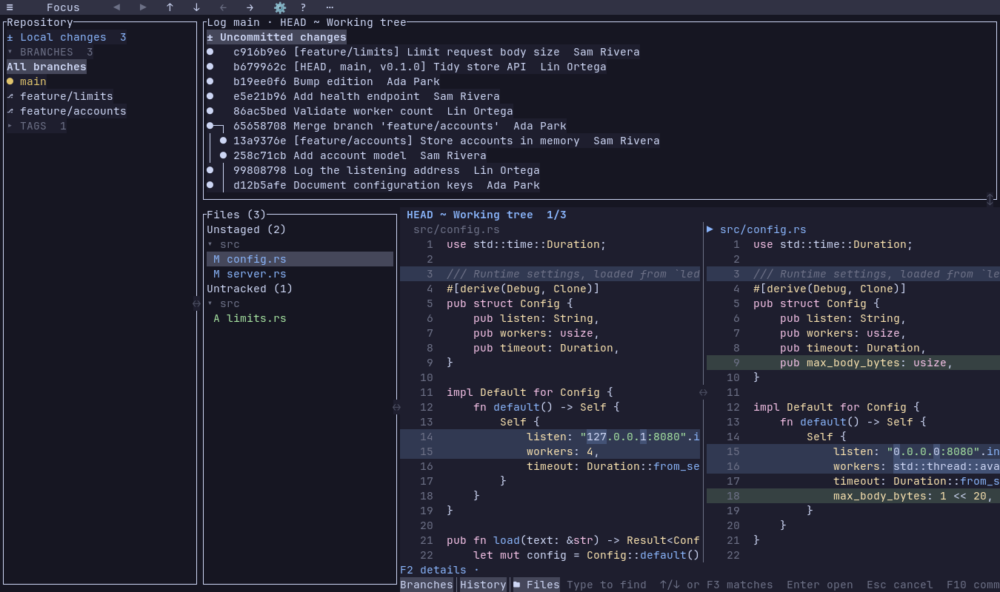
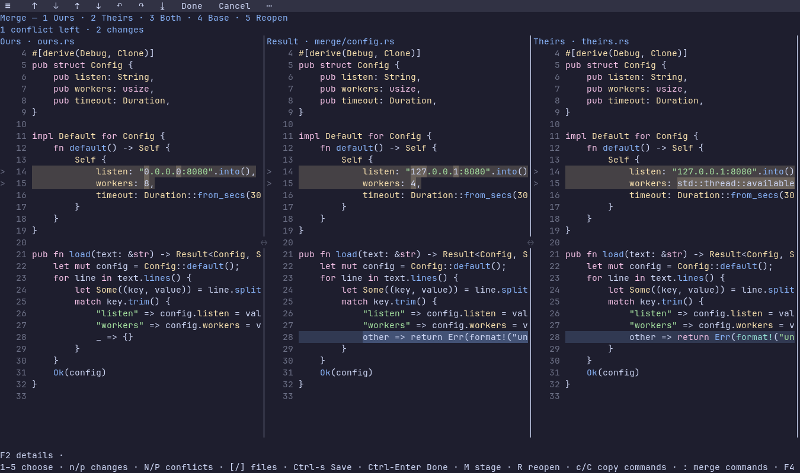

# Terminal frontend



`lenz-tui` is the terminal adapter over the same shared core as the GUI (`lenz`): comparison, editing, merge, repository and pull request, image, annotation and search behavior all live in `crates/app`. This page lists the terminal's controls, where it differs from the GUI and its capability limits. Command-line usage, settings and the feature overview are in the [README](../README.md).

Build it on its own to keep the GPU and windowing dependencies out of the binary:

```sh
cargo build --locked --release -p lenz-tui
./target/release/lenz-tui main...HEAD
./target/release/lenz-tui log --follow src/main.rs
./target/release/lenz-tui merge
```

`lenz-tui` needs an interactive terminal and takes the same arguments as `lenz`, including `--about`. Started outside a repository, `lenz-tui`, `log`, `merge` and `pr` first show the shared repository chooser: type a path (Tab completes folders, `~` is home) or pick a recent repository with the arrows or a click, Enter opens it and Esc quits. The GUI has the same chooser plus **Browse…**, which a terminal cannot offer.

## Keyboard and mouse basics

- **Command palette:** `:` or F10 opens it (the toolbar's `⋯` too). It lists every command from the shared catalog, filtered as you type, with its group, shortcut and, when the command cannot run, the reason. Enter or a click runs a row, Esc closes, F2 explains the selected row. In the Files, Sources and History lists `:` is search text, so use F10 there.
- **Toolbar:** click a control, or press Alt-F10 and use the arrows, Home/End and Enter. `?` sits at the right end, as in the GUI. On a terminal too narrow for every button, the ones that do not fit fold into `⋯`, whose last row opens the palette; otherwise there is no `⋯`, and clicking **F10 commands** in the bottom bar opens the palette (the GUI's **Commands**). Ordinary comparisons hide the Undo/Redo/Save controls even with a dirty draft; they stay in the palette and keep their shortcuts.
- **Help and details:** `?` or F1 opens a wrapped, scrollable shortcut table for the current view. F2 opens the full status message, or the explanation of the selected command, in a scrollable Details dialog; Esc, Enter or F2 closes it and returns to the menu it came from. Merge and Version Picker recovery questions are explained there too.
- **Panes:** Tab/Shift-Tab (or F6) cycle through the visible sources, log, files, comparison sides and search results; hidden panes are skipped. Clicking a pane focuses it. Arrows and Page/Home/End act on the focused pane, and the mouse wheel on the pane under the pointer. Pane dividers drag with the left button; **Reset pane sizes** in the palette restores the default layout.
- **Horizontal scrolling:** each text pane, including all three Merge View panes, keeps its own position. Use the horizontal wheel, Shift-wheel or Ctrl-Alt-Left/Right. Emulators differ in how they deliver horizontal wheel events, so the keys are the reliable route.
- **Context actions:** right click, or Shift-F10 for the focused pane, opens actions for the text, file or commit under the pointer. Text menus list only what applies there (Copy, Fold/Unfold, Move change, Open in editor, blame, and in the Markdown Preview Show in source); **All commands…** opens the palette.
- **Modals:** menus, dialogs and prompts consume all input before the panes below them. Quit (Ctrl-Q) and F8/Shift-F8 are the global exceptions.
- **Lists:** in Files and Commits, typing or Ctrl-F starts a literal, case-insensitive search of that list (file paths; commit subject, author, email and hash in the loaded history). Every row stays visible, matches are highlighted, and Up/Down or F3/Shift-F3 step the candidate without changing the comparison. Enter opens the candidate and keeps the query; Esc clears the search and restores the earlier position; Ctrl-A clears the query; Ctrl-C copies the candidate's path or hash. Plain letters, including `q`, `j`, `k` and `g`, are search text in these lists.
- **Quitting:** Ctrl-Q quits; `q` closes the current view in a comparison or merge.

## Comparison controls

| Operation | Terminal control |
| --- | --- |
| Command palette / focus toolbar | `:` or F10 / Alt-F10 |
| Files / Branches / History / Focus | Alt-1 / Alt-2 / Alt-3 / Alt-0; Esc leaves Focus |
| Back / Forward (repository views) | Alt-Left / Alt-Right, ◀ ▶ |
| Changes / files | n/p or F7/Shift-F7; [ / ] |
| Scroll / focused pane | Arrows, j/k, PageUp/PageDown, Home/End; Tab/Shift-Tab |
| Context / fold / unfold | z / x / X; click a folded row |
| Scroll / whitespace / highlight / case modes | s / w / h / i |
| File finder / go to position | f or Ctrl-P (`name:line[:column]`); g (`line:column` or `line,column`; bad input is reported) |
| Find / next / previous | / or Ctrl-F; F3 / Shift-F3; Alt-C / Alt-W / Alt-R match case, whole word, regular expression (shown as `[Aa W .*]`; a bad expression shows its reason) |
| Find across the Change Set | Ctrl-Shift-F searches both sides; Alt-O limits to changed lines; Alt-C / Alt-W / Alt-R as in find; Enter searches |
| Select / copy | Click or drag, double/triple click for word/line, Shift-arrows, Ctrl-A; y or Ctrl-Shift-C |
| Apply left/right / undo / redo | Alt-Shift-Left/Right; Ctrl-Z; Ctrl-Y or Ctrl-Shift-Z |
| Save | Ctrl-S (in the Sources pane of a repository view Ctrl-S toggles the sidebar; use the toolbar or palette) |
| Applied history / selective undo | A; choose a record and Enter, or click it |
| Blame / commit details | b / B; click an annotation |
| Sticky scroll | command menu “View: Sticky Scroll”, `[view] sticky_scroll` in settings; click a pinned line to jump |
| Editor / default application / reload | o / O / F5 |
| Independent views | F8 / Shift-F8 switch; q closes the current view |

`lenz-tui --about` and **About Lenz** (in ☰ and the palette) show the shared application information. Terminals that support it show the logo as pixels: kitty graphics in kitty and Ghostty, Sixel in foot (detected from `TERM=foot*` or its Linux launcher ancestry), both outside tmux and GNU screen. Other terminals draw a precomputed 24×12 cell logo. `LENZ_IMAGES=cells|kitty|sixel` overrides detection; Sixel applies to About only. The artwork is loaded while About is visible and released when it closes. Esc, Enter or **Close** dismisses it, and the arrows, Page keys and Home/End scroll it at small sizes.

### Editing and saving

Apply, hunk revert, Undo and Redo change a pending draft; **Save changes** writes it. **Discard unsaved changes** reloads the file from disk and restores the last saved history. Drafts survive switching files and refreshing the same comparison. Quitting or changing comparison with drafts focuses an unsaved file and asks you to save or discard first; Cancel keeps the view. Applied changes stay marked Applied or Undone, including after a repository refresh removes a fully applied file from Git's diff. A record can be undone on its own unless a later overlapping edit requires a global Undo, which the Details dialog explains. One-line changes have no folding control. In the Merge View, **Reopen conflict** resets one resolution.

**Revert current hunk** copies the left version into the right working-tree side. **Discard working-tree changes** is a separate confirmed Git action that restores the indexed bytes and mode, keeps staged changes, handles tracked deletions, binary files and symlinks, and offers **Undo Git discard**. Save or discard the file's draft first. It refuses if the file or index changed after you confirmed, and does not apply to untracked files, submodules or conflicts. Undo is kept for at most 64 records and 64 MiB of original bytes; a larger file is refused.

Writes use the same snapshots, encoding and line-ending preservation, read-only rules and external-change guard as the GUI. If Save finds the file changed on disk, nothing is written and the draft stays available. Files under the system temporary directory are read-only for two-way Apply.

### Images

Images draw as colored half-block cells. `m` cycles the modes; `0` fits and `1` shows 1:1; `+`/`-` zoom; arrows pan; `,` / `.` change the opacity or Swipe split; `n`/`p` step through changed regions. Every image command, including copying paths and opening the original externally, is also in the palette.

### Archives

A changed zip or tarball appears in Files as a folder (`bundle.zip/src`) of its changed files, collapsed at first with its file count. They are read-only, and Show file history follows the archive. The GUI behaves the same way; the [README](../README.md#editing-and-saving) lists the formats and limits.

Folder headings in Files collapse and expand: click the ▾/▸ arrow (the heading's first two cells), or use the keys. Up/Down walk files and headings; on a heading the **Folder Summary** shows in the diff area, Left collapses it, Right expands it and Enter toggles it; Left on a file moves to its folder's heading. A click on a heading's name shows its summary too. Click the summary, or Esc out of Files, to give it the keyboard: Up/Down select a file, Enter or a click opens it, Left/Right collapse or expand the folder, and Esc returns to the file behind it. The palette lists the same folder commands as the GUI.

### Markdown Preview

**Source | Inline | Side by side** sit in the pane header of eligible Markdown comparisons and in the palette; the [Markdown Preview guide](markdown.md) covers what is rendered and the source-fidelity rules. Terminal specifics:

- Styling uses terminal attributes. Inline is one full-width pane (also below 70 columns) with removed words struck in red, inserted words green and underlined, whole old blocks struck, and a `▌` in the left margin of each changed block. Side by side marks changed words the same way without the strike, with the same `▌` beside each changed block. Prose wraps between words; wide tables and code scroll horizontally.
- A click on a removed word selects the old text; the arrow keys move a caret in the new text. Foldable callouts show ▸ or ▾ after the title and fold with a click or Enter; a callout containing a change starts open.
- Callouts, `==highlights==`, tags, links, footnotes, properties and done tasks use theme colors and styles (see the guide).
- Local images are decoded in the background and drawn at most 20 rows tall: as real pixels through kitty graphics Unicode placeholders in kitty and Ghostty (not inside tmux), as half-block cells elsewhere. `LENZ_IMAGES=cells|kitty` overrides detection (`sixel` also selects cells here). A missing or unreadable image keeps its placeholder text.
- Three-way merge panes keep their plain rendering. PR conversations share the Markdown file parser and terminal text styles; the GUI also reuses its reading fonts and inline styling in a 30% wider column, formatted in the background. PR tables keep compact text separators and images remain linked placeholders; the timeline does not offer the Preview's image or callout controls. The PR wheel moves one row per notch; the GUI accumulates small trackpad movements instead of treating every event as three rows.

### Themes and icons

The terminal shares the GUI's themes and the [theme IDs, file format and precedence](themes.md). **Change theme** (☰ or the palette) opens a scrollable chooser. Follow system is the default and tracks Omarchy palettes live on Linux; elsewhere the terminal falls back to Darcula, because native terminal appearance is not detected. A manual choice persists until you choose Follow system again. `LENZ_THEME=system|<id>` overrides a launch (`LENZ_APPEARANCE=light|dark` is read only when `LENZ_THEME` is unset), and an explicit menu choice overrides both.

**Nerd Font icons** in ☰ add icons beside the toolbar labels; plain labels are the default. `LENZ_ICONS=nerd|plain` or `[tools] icons` in the settings file chooses at launch, and the menu choice lasts for the current view. Configure a [Nerd Font Mono](https://www.nerdfonts.com/) in your terminal for single-cell glyphs. Lenz installs no fonts. Command menus keep full action names.

## Repository and pull request controls

The commit list appears before the sidebar finishes loading. Very long histories load in steps of about 50,000 commits beyond the furthest visible row; scrolling toward the end, End, a commit search, a log filter or a branch comparison loads more. While paused, the log title reads, for example, "74160+ commits, more as you scroll", and the GUI shows the same wording.

The sidebar first reads 20 local branches, keeping the current branch first. Remote branches and open pull requests also arrive in batches of about 20; a `+` after a section's count and **Load more…** indicate more are available. Branch and remote filters search the whole local inventory in the background; PR filtering covers loaded requests, with **Load more pull requests…** still available. Worktree status and the remaining repository details finish independently of the first comparison. Local refresh keeps the requested branch coverage and cached PR list. GitHub listing and PR fetching use separate workers from local navigation.

Selecting or refreshing a PR in the repository view shows a persistent **Loading pull request…** message, including its number when supplied, until it completes or fails. The previous comparison stays usable; choosing another comparison cancels the loading state and ignores the obsolete result.

- **Panes:** Ctrl-R shows or hides the picker. In the Sources pane Ctrl-S and Ctrl-L toggle the sidebar and the log. Sources are Local Changes, staged, branches, remotes, tags, stashes, worktrees and pull requests; arrows and Enter select, `/` filters, `c`/`C` compare the selected or current branch by merge base or tips, `a`/`b` show all or current-branch history, `s` shows staged changes, and `o` opens a worktree as an independent view.
- **Files:** the commit's files stay listed beside the comparison, grouped by directory and marked with their Git status; selecting a commit replaces the list. Alt-1 toggles the pane, and narrow terminals use the file finder instead.
- **Log:** Shift-arrows select a range and Ctrl-arrows pick two commits. Home/End jump to the first and last row. Type to find a commit without changing the comparison, then Enter to open it. History filters, file history, merge-parent selection, staged changes, writing the commit graph and copying commit details or repository URLs are in the palette and the context menus.
- **Palette aliases:** typed aliases such as `follow`, `graph`, `compare-selected`, `show-in-graph`, `worktree`, `pr`, `open-url` and `refresh-repository` run the matching repository command. Refresh reloads local metadata and history, keeping filters and selection; it never fetches pull requests.
- **Pull requests:** `P` opens a number or URL and `r` refreshes. A PR opens in Focus on its **Conversation** tab: the header, description, comments and reviews as cards in time order, review threads with GitHub's code context (resolved and outdated ones folded), and Reviewers, Checks and Labels beside the timeline (a line under the header when narrow). **Commits** lists the PR's commits, and a hash opens Files changed for that commit alone. **Files changed** is the diff. Click a thread's `path:line ↗` to jump there, `▸` to unfold, a link to open it; right click a card to copy its comment or link. `d` toggles Conversation, Tab/Shift-Tab or `1`/`2`/`3` switch tabs, and Esc returns to Files changed. `v` toggles the local Viewed mark, `t`/`T` show current or outdated threads for the file, and `h` checks the remote head (also on focus). Viewed marks are local; Lenz never submits reviews or comments. GitHub workflows need `gh` authentication and network access. A superseded request stops between API pages, but a running `gh` call is not killed and has no timeout. Fetched `refs/lenz/pr/*` refs are removed when the session closes.

### Overview and Focus

Both frontends share the **Overview** (Branches, History, Files and the diff) and **Focus** (Files and the diff) through the shared layout. Focus hides Branches and History; Alt-2 and Alt-3 are refused there with their reason. A window without a repository has no Overview, and Alt-0 there says why. Enter or a double click on a file in Files enters Focus.

- **Toolbar:** it starts with ☰, then **Focus** in the Overview or **Overview** in Focus, then ◀ ▶. Both views share **⚙** (Layout Split | Unified, whitespace, highlighting, scrolling, context, case, blame); Focus adds **≡ Unchanged** and **?**. A PR's **Conversation | Commits | Files changed** tabs sit in the middle and give way to the Markdown modes when the header is too narrow. The pane header carries **Source | Inline | Side by side** for Markdown and **2-up | Swipe | Onion skin | Difference** for images.
- **Selection Title:** the name of what is compared (`main ~ feature/x`, `v0.1.0 (a1b2c3d)`) leads the diff title line and the History header. The terminal has no window title to carry it.
- **Unified:** one full-width column (deleted rows, then inserted, unchanged once). Selection and copy work on the Side of the row under the pointer, one horizontal scroll covers both Sides, and editing is refused with "Switch to Split to edit". Images and the Preview keep their own layouts.
- **Commit message:** in Focus a commit shows its subject, author, date, hash and body above Files; a range lists its newest 200 commits, each opening on a click. The panel takes at most a third of the column. A click on its first line, or "Show / hide commit message" in the palette, collapses it. Up on the first file gives the panel the keyboard: Up/Down walk a range or scroll one message, Enter or Space opens the commit, Esc or Down past the end returns to Files, Ctrl-C copies the message. The GUI also selects text by dragging; the terminal leaves text selection to the emulator. Working tree, index and pull requests show none.

## Merge, Conflict List and Version Picker



The Merge View's toolbar matches the GUI's: ☰, ↑ ↓ changes, ⇡ ⇣ unresolved conflicts, ↶ Undo, ↷ Redo, ⤓ Save, Done/Cancel and `⋯`. The Version Picker uses the same icons plus Mark resolved and its **Take ‹version›** buttons. The Conflict List adds **File actions ▾** and **Copy command ▾** (continuation and submodule commands). The GUI shows those buttons in the page rather than the toolbar.

| Operation | Terminal control |
| --- | --- |
| Take Ours / Theirs / Both / Base / Reopen | `1` / `2` / `3` / `4` / `5`; right click or Shift-F10 lists the choices for the change under the pointer |
| Apply non-conflicting / resolve simple | `a` / `m` |
| Changes / unresolved conflicts / files | n/p / N/P / [ / ] |
| Base or Result / whitespace / scroll mode | `b` / `w` / `s` (Shared or Padded) |
| Find / focus panes | `/`, F3, Alt-C / Alt-W / Alt-R; Tab, Shift-Tab (including a visible conflict-file list) |
| Undo / redo / start over | Ctrl-Z / Ctrl-Y / Ctrl-Shift-R |
| Save / finish / cancel or dismiss / close | Ctrl-S / Ctrl-Enter / Esc / `q` |
| Reload a changed file | `r` |
| Conflict List: stage saved output / reopen / open a closed merge | `M` / `R` / `o`; Ctrl-R returns to the repository, `c`/`C` copy continuation or submodule commands |
| Palette / nested comparison commands | F10 or `:` / F4 |

Finishing with unresolved conflicts, cancelling with unsaved changes and staging a file with conflict markers need the same repeated confirmation as the GUI. A write over a file changed on disk is refused until you confirm the overwrite or reload with `r`. Rows in the Conflict List reflect dirty and saved state immediately.

In the Version Picker the digit keys take a complete version, including a deletion, binary bytes, a symlink or an executable mode. `b` compares Base in a four-file merge, and `m` allows Merge anyway for large text. Its comparison preview keeps the conflict-file list beside the text and offers the ordinary text and image controls, with F4 opening its full command palette; image 1:1 is `!` because digits select versions. Mergetool exit codes are 0 finished, 1 cancelled and 2 error.

## Differences from the GUI

Both adapters build their menus, labels, availability and disabled reasons from the shared catalog (`crates/app/src/catalog.rs`). Equivalent operations and outcomes are available in both; layouts and shortcuts differ.

- The command palette opens with `:` or F10 instead of Ctrl/Cmd+Shift+P; `f` opens the file finder and Alt-0 is Focus.
- **Diff options…** opens the ⚙ menu, or the palette's Diff group when the button has folded into `⋯`.
- Alt-Left/Right outside a repository only says that Back and Forward work in repository views.
- The Version Picker's **Take ‹version›** buttons and the Conflict List's **File actions ▾** are toolbar items.
- Terminal text selection and Linux primary selection belong to the emulator. Clipboard copy uses OSC 52 and needs terminal support; it transports exact text, and source control characters are drawn visibly.
- Images are limited to cell geometry and colors, except where kitty graphics or Sixel apply as described above.
- The emulator may intercept some modifier keys; the command menus offer an equivalent for every control. Dragging needs an emulator that forwards mouse press, motion and release events.
- There are no draggable scrollbars.

## Architecture

Shared core modules own semantic commands, availability, placement and navigation, write safety, compact undo and history, merge, Version Picker and conflict decisions, repository selection, filters and PR state, image controls, and streamed search and blame. Frontends own layout, input handling, textures or cells, and platform effects. Each binary creates its own sessions; parity comes from the shared implementation, and separate GUI and TUI processes do not synchronize live state.

Repository workflows run through `RepositorySession` in both frontends: opening, background work (sidebar inventory, pull request list, log batches, picked comparisons, a followed file), log movement and clicks, sidebar sources, the log filter, branch compare, file history, refresh, pull requests, the commit-graph write, pane toggles and focus, and the log context menu. Each adapter keeps its own layout state: scroll positions and visible rows, the filter's editing mode and log search. A commit's context menu offers the same commands in both, including Open in New Window (a new window in the GUI, an independent view in the terminal) and Compare with Branch…. The terminal reaches Open on GitHub through the `open-url` command.

Performance rules for the terminal: shared decoded data goes through `Arc`; a comparison is read once; only visible cells and syntax are painted; image pixels are computed for the viewport; superseded queued loads and results are discarded; a two-second fallback keeps pathological diffs usable as plain text while their work finishes; and a superseded history stream stops its Git child. One decoded comparison is retained per independent view and released when the view closes. Idle terminals wait for input with no periodic redraw, and pending background work uses an inbox poll. A single Crossterm event stream owns input and shares its wait with theme updates. See the [benchmark guide](benchmarking.md) and [performance overview](performance.md).

## Verification and capability limits

Core tests cover behavior and exact file bytes. Real GPUI `TestWindow` and Ratatui event and render tests cover each adapter's controls and presentation, and owned pseudo-terminal tests cover byte feedback, resize, repository and merge workflows, and raw-mode restoration. The adapters replay the same document, disk and history expectations for text and merge cases, including seeded generated sequences (`LENZ_FLOW_SEED=<n>` reproduces a failure), modal checks at normal, narrow and tiny sizes, and pending-work checks for cancellation, late results, switching, reloading, resizing and a shrinking file list with a retained draft. Run the full set with:

```sh
scripts/ci-local.sh
cargo test -p lenz --features gui-test gui_
python3 scripts/check-user-flows.py --rounds 3
```

`check-user-flows.py` can also drive the release binaries natively (`--gui-app`, `--tui-app`, `--xvfb`); that needs Linux, Xvfb, ImageMagick and Tesseract. Screenshots are evidence for visual inspection, not pixel assertions, and repeating registered tests is not exhaustive state exploration.

Limits to be aware of:

- Linux is the validation platform. Native display latency, macOS execution and live GitHub timing are unverified; offline PR fixtures cover review states and controls.
- Tests and shared behavior reduce drift between the adapters but cannot guarantee that every rendering or input bug is absent.
- New behavior must be usable and verified in both adapters, and performance-sensitive changes need equivalent release workloads compared before and after.

Both adapters offer **Report last error** in their command menus, even before a comparison is ready. `lenz-tui report --last` also works outside Git without an interactive terminal, and `--print` prints the report path and issue-draft link. On a panic the terminal restores mouse, paste, focus and raw/alternate-screen modes before diagnostics print. See [crash reporting](crash-reporting.md).
